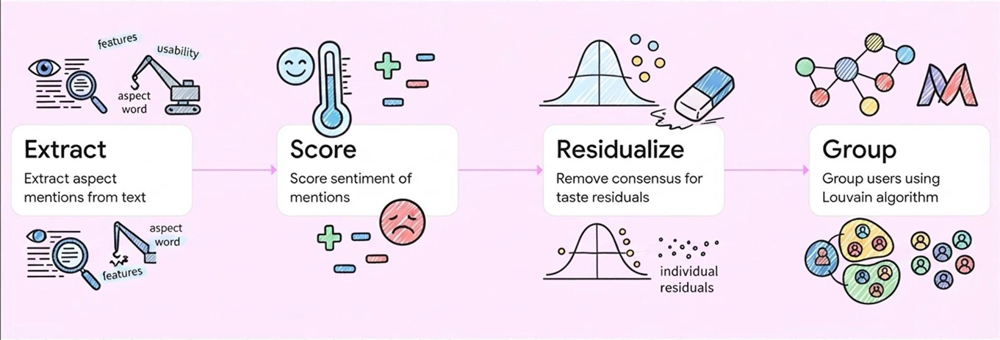
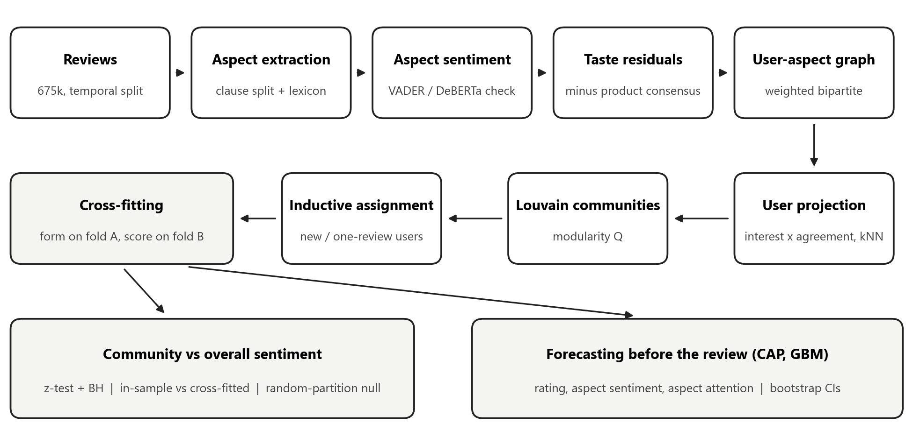
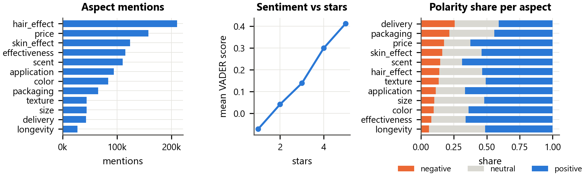
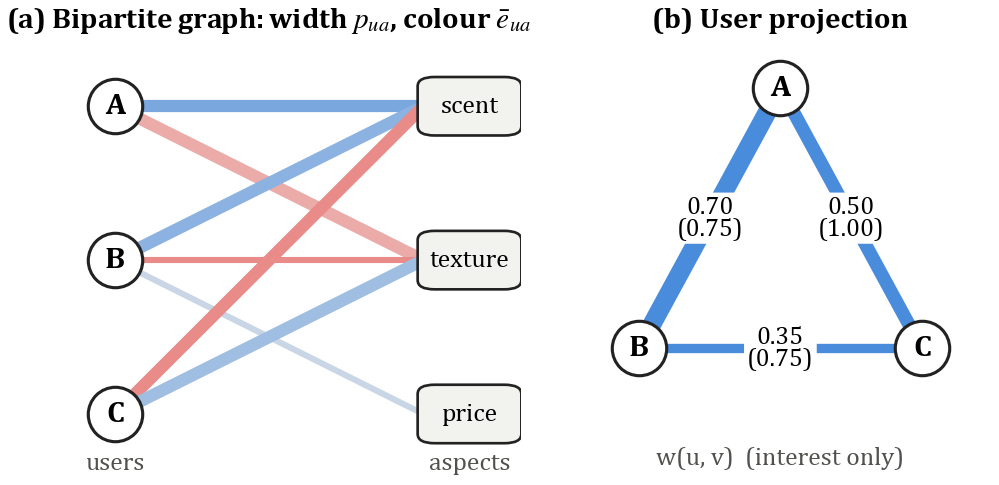
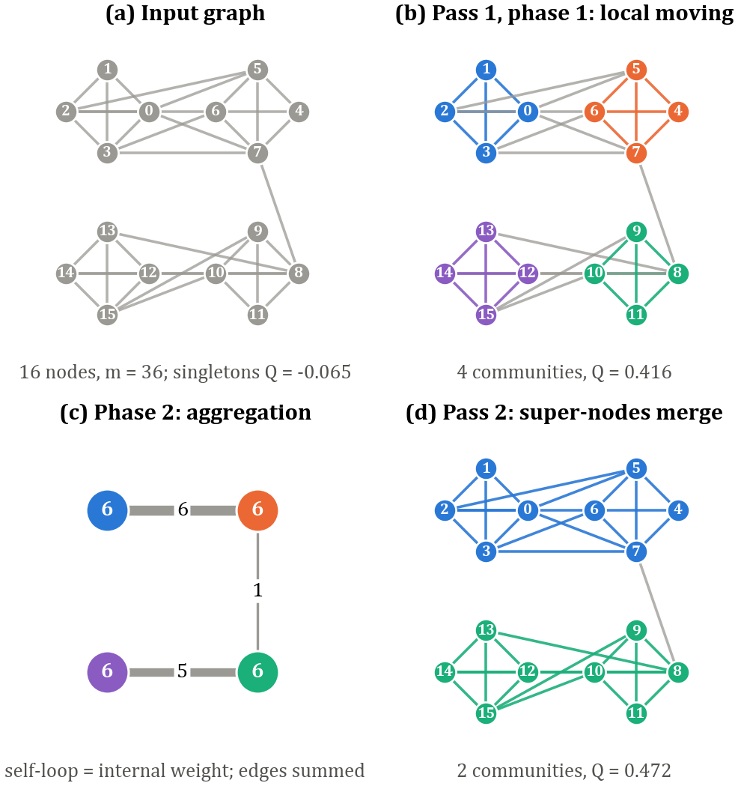
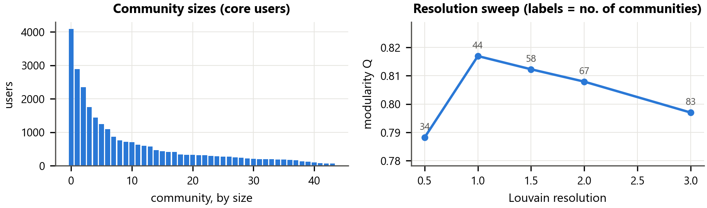
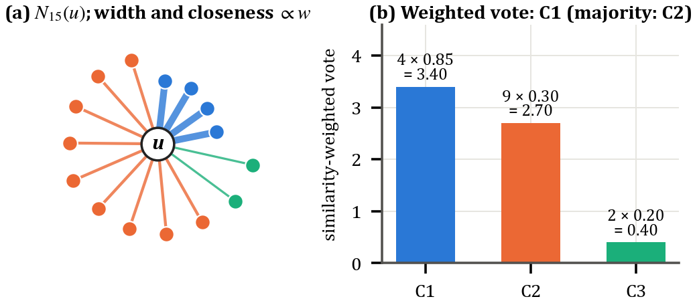
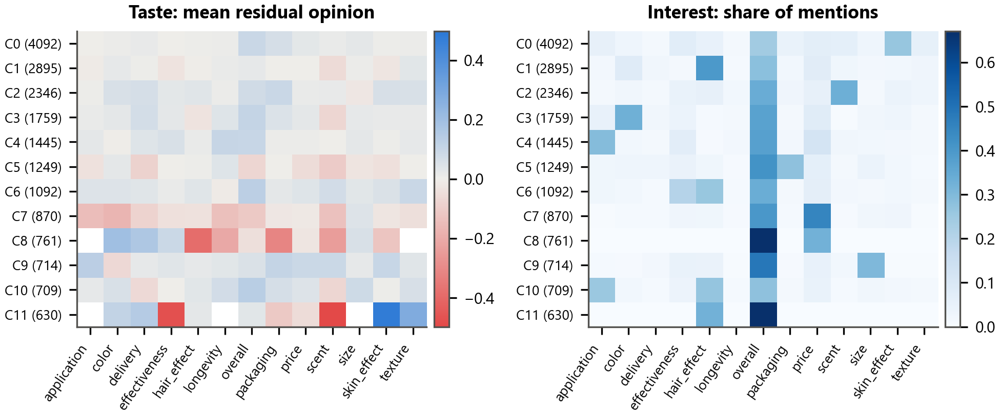
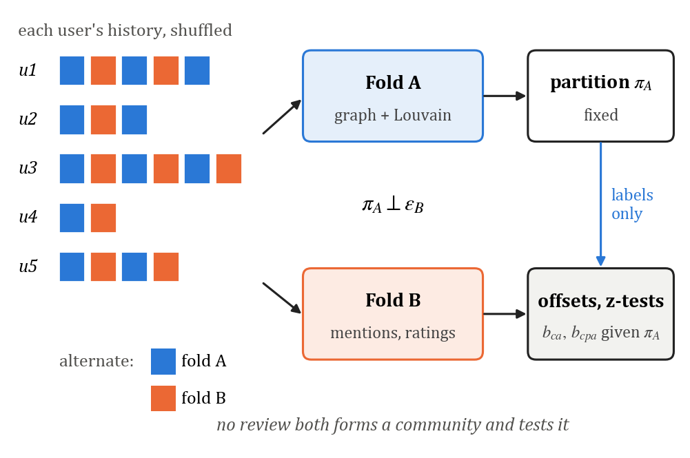
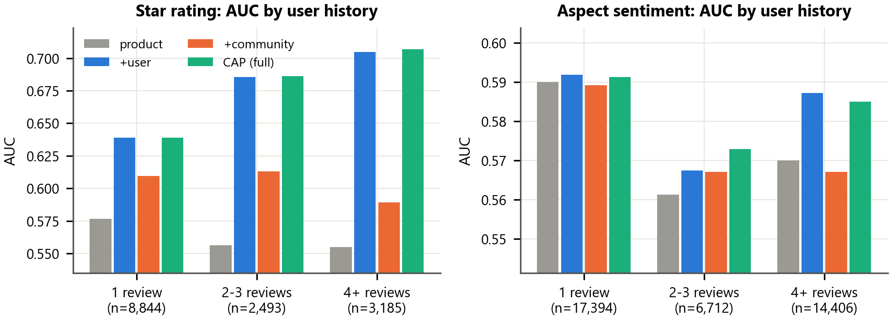

# Community-Aware Aspect-Based Sentiment Analysis

[](https://colab.research.google.com/github/krizz711/community-aware-absa/blob/main/notebooks/community_aware_absa.ipynb)

<p align="center">
  
</p>

Aspect-based sentiment analysis (ABSA) usually treats every reviewer as interchangeable. This project
asks two questions:

1. Do reviewers form **communities**, groups that care about the same product aspects and feel the
   same way about them?
2. If they do, does knowing a reviewer's community **change or improve** what we can say about
   sentiment?

We build the complete pipeline on **674,965 Amazon beauty reviews** and evaluate it under a strict,
leakage-free protocol, in which every community result is checked against a random-partition control.

> **Headline.** Louvain finds 44 strong taste communities (modularity $`Q = 0.817`$, against $`-0.001`$ for a
> random partition). But once communities are formed and tested on separate data, the share of
> "significant" community-vs-overall differences falls from **28.8% to 1.7%**, and communities add
> nothing beyond a user's own history.

## Pipeline

<p align="center">
  
</p>

| Module | Contents |
|---|---|
| `src/cabsa/data.py` | Download Amazon Reviews 2023; global time split (history before 2021, test after) |
| `src/cabsa/aspects.py` | 12-category aspect lexicon, sentence and clause splitting at contrast words, and spaCy noun-phrase mining |
| `src/cabsa/sentiment.py` | Clause-level VADER; DeBERTa-v3 ABSA scorer (`yangheng/deberta-v3-base-absa-v1.1`) |
| `src/cabsa/graph.py` | Bipartite graph, GPU kNN similarity projection, Louvain, inductive assignment, k-means and random controls |
| `src/cabsa/analysis.py` | Community vs rest shift tests (z-test + BH), cross-fitting folds, community profiles |
| `src/cabsa/forecasting.py` | Residualisation, the CAP hierarchical model, cross-fitted community offsets, GBM, clustered bootstrap |
| `src/cabsa/attention.py` | Forecasting *which* aspects the next review will mention |
| `src/cabsa/viz.py` | Shared figure style |
| `notebooks/community_aware_absa.ipynb` | The end-to-end notebook in 9 sections, generated by `notebooks/build_notebook.py` |

## The method, step by step

### 1. From text to taste residuals

Each review is split into clauses at contrast words, and each clause is matched to one of 12 aspect
categories (scent, texture, price, ...). A mention $`m = (\text{review } r,\ \text{clause } k,\ \text{aspect } a)`$
is scored with VADER:

```math
x=\sum_{w\in\text{clause}} v_w\ (\text{after rules}),\qquad s=\frac{x}{\sqrt{x^2+\alpha}},\quad \alpha=15
```

Raw sentiment mostly measures the *product*: everyone praises a good serum. To compare *people*, we
remove the aspect mean and the product's shrunk offset, and keep what is left, the **taste residual**:

```math
\mu_a=\text{mean}\,\{s_m : m \text{ on aspect } a\},\qquad
b_{pa}=\frac{\sum_{m\in(p,a)}\left(s_m-\mu_a\right)}{n_{pa}+\lambda_p},\qquad \lambda_p=5
```

```math
\boxed{\,e_m=\text{clip}\,\big(s_m-\mu_a-b_{pa},\,-1,\,1\big)\,}
```

Each user then gets 13 numbers for **interest**, $`p_{ua}=N_{ua}/\sum_{a'}N_{ua'}`$ (share of mentions),
and 13 for **taste**, $`s_{ua}=\text{mean}\,(e)`$ over their mentions of $`a`$: the 12 aspects plus
an "overall" dimension built from the star-rating residual.

<p align="center">
  
</p>

*Aspect mentions, mean sentiment against stars (it rises monotonically, Spearman ρ = 0.50), and the
polarity share of each aspect.*

### 2. Bipartite graph → user–user similarity

Users and aspects form a weighted bipartite graph: edge $`(u,a)`$ exists when $`N_{ua}\gt 0`$, its weight is
the mention count, and it carries the mean residual $`s_{ua}`$. Projected onto users, two people are
similar when they care about the same aspects **and** deviate from the consensus in the same direction:

```math
w(u,v)=\sum_{a}\ \underbrace{\min(p_{ua},p_{va})}_{\text{shared interest}}\ \cdot\ \underbrace{\Big(1-\tfrac{|s_{ua}-s_{va}|}{2}\Big)}_{\text{opinion agreement}\ \in[0,1]}
```

Each user keeps their $`k=15`$ most similar neighbours. Edges with $`w\lt 0.05`$ are dropped and the graph
is made symmetric by taking the max. The projection runs on the GPU in chunks
($`26{,}966^2\times13\approx9.5\times10^9`$ terms).

<p align="center">
  
</p>

*(a) A toy bipartite graph: edge width is interest, colour is the taste residual. (b) The user
projection it produces. The number in brackets is the interest-only weight, so agreement is what
separates A–B (0.70) from A–C (0.50).*

### 3. Louvain: maximising modularity

```math
Q=\frac{1}{2m}\sum_{i,j}\Big[A_{ij}-\gamma\,\frac{k_i k_j}{2m}\Big]\,\delta(c_i,c_j)
```

- $`A_{ij}=w(i,j)`$ is the edge weight, and $`k_i=\sum_j A_{ij}`$ is the weighted degree.
- $`m=\tfrac12\sum_{ij}A_{ij}`$ is the total weight, $`\gamma`$ is the resolution (we use 1), and
  $`\delta(c_i,c_j)=1`$ when $`i`$ and $`j`$ are in the same community.
- $`k_i k_j/2m`$ is the weight we would **expect** between $`i`$ and $`j`$ if edges were rewired at random
  with every degree kept (the configuration-model null).

The same $`Q`$ can be written per community:

```math
Q=\sum_{c}\Big[\frac{\Sigma^{c}_{\text{in}}}{2m}-\gamma\Big(\frac{\Sigma^{c}_{\text{tot}}}{2m}\Big)^{2}\Big]
```

and the gain when an isolated node $`i`$ joins community $`C`$ is

```math
\Delta Q=\frac{k_{i,C}}{m}-\gamma\,\frac{k_i\,\Sigma^{C}_{\text{tot}}}{2m^{2}}
```

where $`k_{i,C}`$ is the total weight from $`i`$ into $`C`$. A node joins a community when it has more
links into it than chance would give.

<p align="center">
  
</p>

*Both Louvain passes on a 16-node toy graph (m = 36), from our own run. (a) Singletons, Q = −0.065.
(b) Phase 1, local moving: 4 communities, Q = 0.416. (c) Phase 2, aggregation: each community becomes
one node, its internal weight becomes a self-loop, and edges between communities are summed. (d) Pass 2
merges the super-nodes: 2 communities, Q = 0.472. The method is from Blondel et al. (2008).*

- **Phase 1, local moving.** Visit every node and move it to the neighbouring community with the
  largest positive $`\Delta Q`$. Repeat until no move helps.
- **Phase 2, aggregation.** Each community becomes one node, and the two phases repeat on the smaller
  graph until $`Q`$ stops rising. Each pass costs about $`O(m)`$, so the method is close to linear.

**On our graph** (26,966 core users, those with at least 2 reviews):

<p align="center">
  
</p>

- **44 communities** with $`Q = 0.817`$. A size-matched random partition (same sizes, members
  shuffled) gives $`Q = -0.001`$.
- **Resolution sweep:** $`\gamma = 1`$ gives the highest $`Q`$. $`\gamma = 0.5`$ gives 34 communities and
  $`\gamma = 3`$ gives 83.
- **Seed stability:** the mean ARI over 5 Louvain seeds is 0.617 (min 0.530), where
  $`\text{ARI}=\frac{RI-\mathbb{E}[RI]}{\max RI-\mathbb{E}[RI]}`$ is 1 for identical partitions and 0 for
  chance. The broad structure repeats, but the borders move.

### 4. Placing one-review users

93.3% of users have only one review, so they cannot be core nodes. A new user $`u`$ joins the community
with the largest similarity-weighted vote among their 15 nearest core users, $`N_{15}(u)`$:

```math
\hat c(u)=\arg\max_{c}\sum_{v\in N_{15}(u)} w(u,v)\,\mathbf 1[c_v=c]
```

<p align="center">
  
</p>

*A plain majority vote would pick C2 (9 of 15 neighbours). The weighted vote trusts the closer
neighbours and picks C1 (4 × 0.85 = 3.40 against 9 × 0.30 = 2.70). This needs one row of similarities
per new user and no re-clustering. 7,647 users were placed this way, and 100% of test users have a
community.*

### 5. What the communities look like

<p align="center">
  
</p>

*The 12 largest communities (sizes in brackets). Left: taste, the mean residual opinion on each aspect.
Right: interest, the share of mentions each aspect gets.*

### 6. Testing without double dipping: cross-fitting

Communities are built from users' reviews, so testing community-vs-overall differences on those same
reviews is circular ("double dipping"; Kriegeskorte et al., 2009). Each user's history is shuffled and
alternated into two folds: communities are formed on fold A and tested on fold B.

For each community $`c`$ and aspect, $`p_1`$ is the share of positive mentions inside $`c`$ and $`p_2`$ is the
share for everyone else ($`n_1, n_2 \ge 30`$):

```math
\hat p=\frac{n_1p_1+n_2p_2}{n_1+n_2},\qquad z=\frac{p_1-p_2}{\sqrt{\hat p(1-\hat p)\big(\frac1{n_1}+\frac1{n_2}\big)}},\qquad p\text{-value}=2\big(1-\Phi(|z|)\big)
```

All $`M`$ p-values are then corrected with Benjamini–Hochberg:

```math
p_{(1)}\le\dots\le p_{(M)},\qquad \tilde p_{(i)}=\min_{j\ge i}\frac{M\,p_{(j)}}{j}
```

<p align="center">
  
</p>

*Fold A forms the partition. Fold B, which played no part in forming it, estimates the community
offsets and runs the tests.*

| Setting | Tests | Raw p < 0.05 | After BH |
|---|---|---|---|
| In-sample, real communities | 104 | 37.5% | **28.8%** |
| In-sample, random partition | 120 | 8.3% | 0.0% |
| Cross-fitted, real communities | 117 | 14.5% | **1.7%** |
| Cross-fitted, random partition | 118 | 11.0% | 0.0% |

That is 30 significant tests in-sample, but only 2 once communities are tested on reviews they never
saw. The random partition gives 11% raw rather than 5% because mentions from the same user are
correlated while the z-test treats them as independent, so its p-values come out too small. That is
why every result is compared with the random partition, not with 5%.

### 7. CAP: Community-Anchored Partial pooling

Predict user $`u`$'s sentiment on aspect $`a`$ of product $`p`$ **before the review is written**:

```math
\hat s(u,p,a)=\mu_a+b_{pa}+b_{ca}+b_{cpa}+\tilde b_{ua}
```

| Term | Meaning |
|---|---|
| $`\mu_a`$ | Global mean sentiment on aspect $`a`$ |
| $`b_{pa}=\frac{\sum (s-\mu_a)}{n_{pa}+\lambda_p}`$ | The product's offset ($`\lambda_p=5`$) |
| $`b_{ca}=\frac{\sum_{v\in c,\,v\ne u} e}{n_{ca}^{(-u)}+\lambda_c}`$ | The community's offset, from other members only |
| $`b_{cpa}=\frac{\sum (e-b_{ca})}{n_{cpa}+\lambda_{cp}}`$ | The community's opinion of this product |
| $`\tilde b_{ua}=\frac{\sum (e-b_{ca})}{n_{ua}+\lambda_u}`$ | The user's own residual after the community offset |

Every level is shrunk as $`\text{sum}/(n+\lambda)`$. This is the Bayesian posterior mean: if
$`b\sim\mathcal N(0,\tau^2)`$ and each mention is $`b`$ plus $`\mathcal N(0,\sigma^2)`$ noise, then
$`\mathbb E[b\mid\text{data}]=\frac{\sum d}{n+\sigma^2/\tau^2}`$, so $`\lambda=\sigma^2/\tau^2`$. The values
$`(\lambda_c,\lambda_{cp},\lambda_u)\in\{1,3,10,30,100\}^3`$ are tuned on a 2020 validation period, and the
community offsets are cross-fitted.

<p align="center">
  
</p>

*Forecast AUC by how much history the user has. The community beats product-only, but once the user's
own history is in, CAP adds nothing (CAP ≈ +user in every stratum).*

## Results (All_Beauty; history before 2021-01-01, test 2021–2023)

| | Result |
|---|---|
| Data | 674,965 reviews, 615k users, 111k products. The test set is 14,522 later reviews by 9,785 returning users, and 62% of test products had no reviews before the cutoff |
| Aspects | 1.12M aspect mentions; 67% of reviews mention at least one aspect |
| Sentiment validity | Mean aspect sentiment rises monotonically with stars (Spearman ρ = 0.50). VADER agrees with DeBERTa-ABSA on 64% of mentions (κ = 0.36), and DeBERTa tracks stars better (ρ 0.47 vs 0.36 on a 2,000-mention sample) |
| Communities | 26,966 core users form 44 communities with modularity Q = 0.817; a size-matched random partition scores −0.001. Mean ARI across seeds is 0.62. All test users receive a community (7,647 inductively) |
| Community vs overall, **in-sample** | 28.8% of community–aspect differences are significant after BH correction, against 0% for a random partition |
| Community vs overall, **cross-fitted** | Only 1.7% are significant (BH), against 0% for a random partition. Before correction, 14.5% have p < 0.05 against 11.0% for random. **Most of the in-sample effect is circular, though a weak real signal remains** |
| Rating forecast, community alone | AUC 0.615 vs 0.564 for product-only, a gain of +0.051 (95% CI 0.040–0.062). Communities do carry real information |
| Rating forecast, CAP vs the user's own history | 0.657 vs 0.660, a difference of −0.004 (95% CI −0.006 to −0.001). Within every history stratum the CI includes 0. Cross-fitting fixes the naive in-sample CAP (0.640, +0.016 [0.009, 0.024]), but communities still add nothing beyond the user's history. The same holds for GBM: +user 0.665 vs +user+community 0.660 |
| Aspect-sentiment and aspect-attention forecasts | Same pattern: community information is redundant with personal history |
| Ablation | Once user history is included, the taste, raw-sentiment and interest-only partitions are no better than a random partition (CAP rating AUC 0.646–0.660 vs 0.656), and k-means is worse (0.625) |

**Main finding.** Opinion communities in product reviews are structurally strong (high modularity,
stable across seeds) and do carry predictive information on their own. Two qualifications apply:

1. Most of the community-vs-overall sentiment differences reported by the usual in-sample analysis come
   from testing on the same data used to form the communities ("double dipping"; Kriegeskorte et al., 2009).
   Under cross-fitting, significant differences fall from 28.8% to 1.7%.
2. Under a leakage-free protocol, communities do not improve on a user's own shrunk history, even for
   one-review users, because the communities are themselves built from that history.

Communities would add new information only if they came from a signal independent of the user's own
reviews, such as a friendship graph.

## How this differs from prior work

- **User and product models for sentiment** (Tang et al., 2015; Chen et al., 2016; Amplayo et al., 2018)
  personalise *document-level text classification* with per-user embeddings. We test a **group level**
  (communities), at the **aspect level**, in a **no-text forecasting** setting, with explicit
  cold-start strata.
- **Community detection combined with sentiment** (Tan et al., 2011; Deitrick & Hu, 2013; Kalashi et al.,
  2025) reports community structure and community-level sentiment **in-sample**. We add cross-fitting
  and a random-partition null, and show that most of this kind of evidence is circular.
- **Aspect-aware recommenders** (McAuley & Leskovec, 2013; Zhang et al., 2014) use latent per-user
  factors. Our communities are explicit and interpretable as taste profiles, and new users can be
  assigned to them inductively.

The full APA reference list (44 entries) is in [`docs/references.md`](docs/references.md). The Louvain
method is from Blondel, V. D., Guillaume, J.-L., Lambiotte, R., & Lefebvre, E. (2008). *Fast unfolding of
communities in large networks*. Journal of Statistical Mechanics, P10008.

## Run

**Colab.** Click the badge, choose *Runtime → Change runtime type → T4 GPU*, then *Run all*. A run
takes about 15–20 minutes and downloads about 330 MB. The last cell downloads `results.zip` with every
figure and table.

**Locally:**

```bash
pip install -r requirements.txt
python -m spacy download en_core_web_sm
jupyter notebook notebooks/community_aware_absa.ipynb
```

## Data

Hou, Y., Li, J., He, Z., Yan, A., Chen, X., & McAuley, J. (2024). *Bridging language and items for
retrieval and recommendation*. arXiv:2403.03952.
[Amazon Reviews 2023 on Hugging Face](https://huggingface.co/datasets/McAuley-Lab/Amazon-Reviews-2023)
